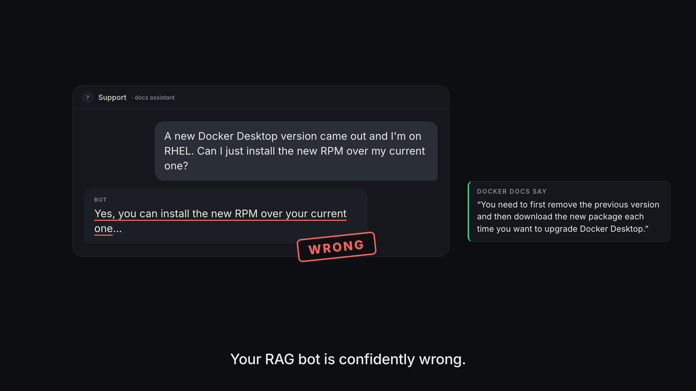
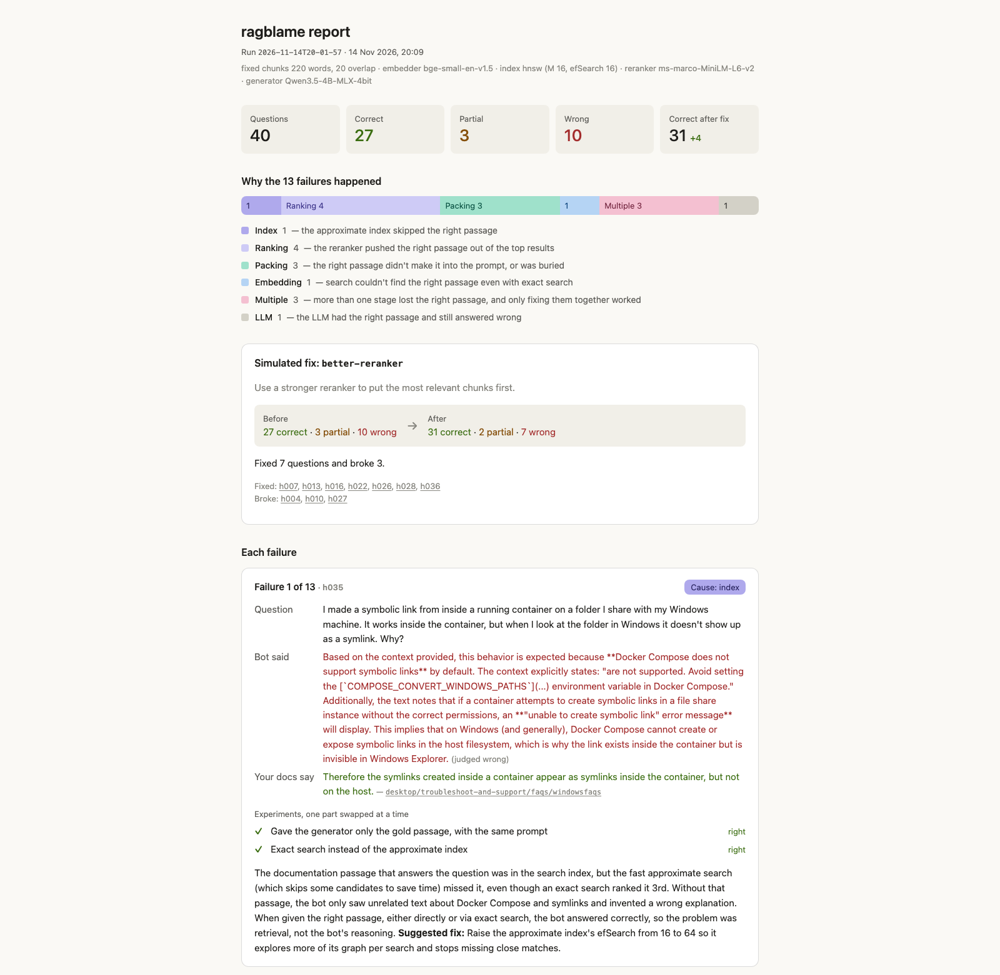

<p align="center"></p>

<p align="center"><b>git blame for wrong RAG answers.</b> Find which stage broke, prove it, then prove the fix.</p>

<p align="center"></p>

[](https://github.com/pulkitnagpal/ragblame/releases/download/v1.0.0/ragblame-1.0.mp4)

*Watch the film (60 s). Every question, answer, rank and number in it is from a real run.*


## The problem

Your support bot just told a customer something wrong. The right page is in your docs. So which part
broke?

A RAG bot is a chain: it **chunks** your docs, **embeds** them, searches an approximate **index**,
**reranks** the candidates, **packs** a few into the prompt, and the LLM **generates** an answer. A wrong
answer can come from any link, and the logs rarely say which. So teams guess: change the chunk size, try
another embedding model, add a reranker, tweak the prompt, and hope.

Eval tools (RAGAS, DeepEval, Phoenix, LangSmith…) give you scores. A score tells you something is wrong,
not what to fix.

## What ragblame does

For every wrong answer, ragblame re-runs the question with **one stage swapped for a perfect version**,
and the first swap that flips the answer to correct is the culprit. Like a mechanic swapping in a
known-good part:

1. **Find the truth.** Where in your docs is the answer? (No passage: a **docs gap**.)
2. **Oracle test.** Hand the LLM only the correct passage. Still wrong? It's **generation**: no amount of
   retrieval tuning will fix it.
3. **Trace it.** Where did the correct passage drop out? Split across chunks? Missing even from exact
   search? Skipped by the approximate index? Pushed down by the reranker? Left out of the prompt?
4. **Prove it.** Re-run with that stage made perfect: re-chunk so the answer sits whole, use exact search,
   put the passage first... Only a swap that makes the answer *correct* counts.
5. **Fix it, measurably.** `ragblame fix <name>` applies the matching real fix (heading-aware chunks, a
   better reranker, a bigger index search, a quote-first prompt) to *every* question and shows what it
   fixed and what it broke.

Claude does the reasoning around the experiments: it writes test questions with exact supporting quotes,
judges every answer against the docs, and explains each verdict in plain English. The bot under test runs
fully locally.

## What happened on the Docker docs

The demo bot is a typical RAG setup over **287 pages of Docker's documentation** (Apache-2.0): 220-word
chunks, `bge-small-en-v1.5` embeddings, a FAISS HNSW index with default settings, the
`ms-marco-MiniLM-L6-v2` reranker, and Qwen3.5 4B answering on an M5 Pro.

**Default question set (60 questions, written by Claude from the docs):** the bot got **55 right**. All 5
failures were diagnosed, each one differently:

| Question | Verdict | The experiment that proved it |
|---|---|---|
| "My autobuilds email me every time... which setting gets emails only when a build breaks?" | **index** | The answer ranked **#1 under exact search**, but the approximate index never returned it. Exact search → correct. |
| "Where do I need to put registry.json on Ubuntu laptops?" | **ranking** | Search ranked the Linux path **3rd**; the reranker pushed it to **13th**, out of the prompt. Putting it back on top → correct. |
| "Can I just install the new RPM over my current one on RHEL?" | **distracted** | The right passage was packed **first**, yet the bot said "Yes, you can". Given only that passage → correct. |
| "Do I get Compose and Kubernetes with Docker Desktop?" | **multiple** | Only fixing embedding, index *and* ranking together got the passage through. |
| "Which roles can stop people making public repos...?" | **generation** | Even given only the correct passage, the answer was only partly right. |

**Harder set (40 questions about specific details: table rows, limits, conditions, platform
differences, asked in a user's own words):** **27 right, 3 partial, 10 wrong**. The 13 failures:
ranking 4, multiple 3, packing 3, generation 1, embedding 1, index 1.

**Did the verdicts point at the right fix?** The top cause on the harder set was ranking, so ragblame
suggested a stronger reranker. `ragblame fix better-reranker` swapped `ms-marco-MiniLM-L6-v2` for
`ettin-reranker-150m-v1` and re-ran all 40 questions: **27 → 31 correct** (7 fixed, 3 broken, both
listed in the report). The 7 it fixed line up with the diagnosis:

| Verdict | Questions | Fixed by the reranker swap |
|---|---|---|
| ranking | 4 | **3** |
| packing (passage ranked just below the prompt cut-off) | 3 | **3** |
| multiple (embedding + index + ranking) | 3 | 1 |
| index, embedding, generation | 3 | **0**, as the verdicts predicted |

That's the point of ragblame: it tells you which fix to try, and the simulation proves whether it
helped before you ship it, including what it broke.

**Can you trust the judge?** Every number above rests on an LLM judge (Sonnet). A stricter, separate
reference pass (Opus, which lists each fact the answer needs) re-marked 20 answers: **95% agreement
(19/20)**. The one disagreement is in the report's appendix.

**Does it find the right stage? The benchmark.** `ragblame bench` breaks the healthy bot on purpose,
one stage at a time (40-word chunks, scrambled embeddings for some docs, a starved index, a reversed
reranker, a 60-word prompt budget, a deleted doc), keeps the questions that flip from right to wrong,
and asks three methods to name the broken stage. We know the true answer because we caused it.
30 injected failures, scored strictly:

| Method | Right stage |
|---|---|
| An LLM reading the logs (retrieved chunks, scores, prompt, answer) plus the correct passage | 23/30 (77%) |
| ragblame's trace step alone: where did the correct passage drop out? (no LLM, no re-runs) | **27/30 (90%)** |
| Full ragblame: blame a stage only if making it perfect flips the answer to correct | 23/30 (77%), or 25/30 counting "multiple" verdicts that include the true stage |

What this says, honestly:

- **The trace is the big win over reading logs.** ragblame runs an exact search next to the bot's own
  index, so it can tell "the index skipped it" from "search couldn't find it at all". The log-reading
  LLM got only **1 of 6** index faults; the trace got 6/6.
- **The re-runs are stricter, not more accurate on single faults.** When the swap alone doesn't flip
  the answer (the 4B model is sometimes flaky even with the right passage), ragblame says "multiple"
  or "unresolved" rather than guess. What the re-runs buy you is proof and the fix measurement above.
- **The benchmark caught a bug in ragblame itself.** On its first run, the packing swap kept the
  fault's tiny budget and truncated the correct passage, scoring 0/5 on packing. A perfect packing
  stage now always gets the whole passage in (`test_packing_swap_keeps_whole_gold_chunk_when_budget_truncates`).
- The prompt fault ("trust your own memory") flipped none of the 12 questions, so generation isn't
  covered here. Small numbers: treat these as indicative.

<p align="center"></p>

The full reports from both runs are in [`examples/runs/`](examples/runs/) (download and open the HTML).

## Learn RAG from this repo

`docs/learn/` walks through every stage using real output from these runs:
[what RAG is](docs/learn/01-what-is-rag.md) ·
[chunking](docs/learn/02-chunking.md) ·
[embeddings](docs/learn/03-embeddings.md) ·
[the vector index](docs/learn/04-vector-index.md) ·
[reranking](docs/learn/05-reranking.md) ·
[packing](docs/learn/06-packing.md) ·
[generation](docs/learn/07-generation.md)

## Run it

Needs macOS on Apple Silicon (the demo bot uses MLX), Python 3.12, [uv](https://docs.astral.sh/uv/) and
the [Claude Code](https://claude.com/claude-code) CLI, signed in.

```bash
uv sync
uv run ragblame ask "How many image pulls does a free Docker account get?"
uv run ragblame run                                  # answer, judge and diagnose data/questions.jsonl
uv run ragblame fix better-reranker runs/<id>        # simulate a fix across every question
uv run ragblame bench runs/<id>                      # break the bot on purpose, score the diagnosis
open runs/<id>/report.html
```

Claude calls are cached on disk (`.ragblame/`), so re-running costs nothing. To pass a Claude Code token
from the macOS Keychain, set `RAGBLAME_KEYCHAIN_SERVICE` to the item's service name; it's held in memory
only.

**Your own pipeline:** implement `search`, `rerank`, `pack`, `answer` and `chunks` (see the `Pipeline`
protocol in [`ragblame/pipeline.py`](ragblame/pipeline.py)) and call `ragblame.diagnose.diagnose`. Add an
optional `rechunk(gold)` to unlock the chunking experiment. [`examples/my_pipeline.py`](examples/my_pipeline.py)
is a minimal keyword-search bot wired up this way.

## How it compares

| | Scores answers | Names the broken stage | Proves it by re-running | Measures a fix |
|---|---|---|---|---|
| RAGAS, DeepEval, Phoenix, LangSmith | yes | no | no | no |
| RAGChecker (Amazon, 2024) | yes | retriever vs generator | no | no |
| RAGGY (Berkeley, 2025) | | you, by hand | you, interactively | no |
| RAGLog (Nov 2026) | | from logs | no | no |
| **ragblame** | yes | 8 causes | **yes** | **yes** |

## Honest limits

- The judge and the reference labels are both LLMs. The reference labels come from a stricter Opus
  pass, not from people (see the agreement number above).
- The test questions were written by Claude from the docs, so they're cleaner than real user questions.
  That's why there's a second, harder set, reported separately.
- The benchmark is small (one fault per stage, a handful of cases each), so treat its numbers as
  indicative, not precise.
- "multiple" means only a combination of swaps fixed the answer; ragblame doesn't split the blame further.
- The demo bot needs Apple Silicon; the diagnosis itself is plain Python and works on any pipeline that
  implements the protocol.

## Licence

Code: Apache-2.0. The Docker documentation excerpts in `data/docker/` are Apache-2.0, Docker Inc.; see
[`data/docker/NOTICE`](data/docker/NOTICE). Docker is a trademark of Docker, Inc., and this project isn't
affiliated with it.
